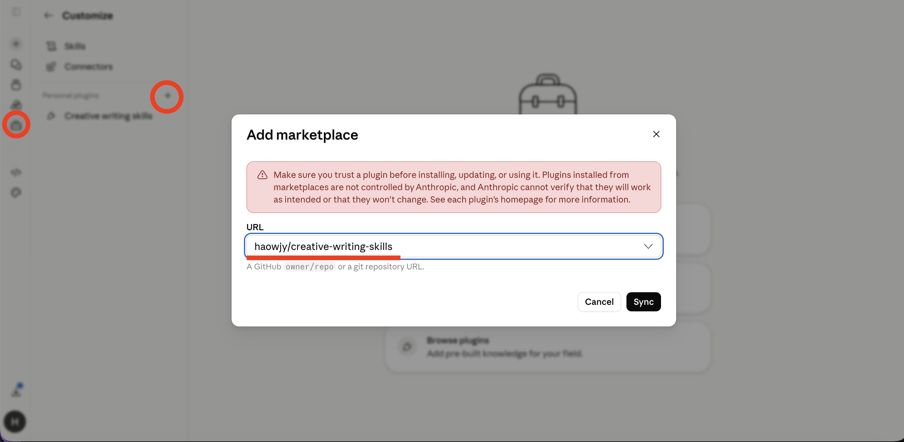
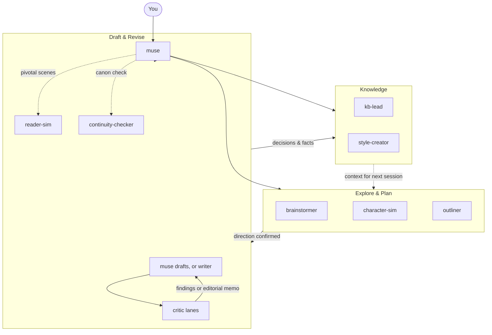

# Creative Writing Skills

[](https://github.com/haowjy/creative-writing-skills/actions/workflows/ci.yml)
[](LICENSE)

Write novels, short stories, and serial fiction with AI that maintains your voice, tracks your continuity, and gets better the more you use it. From first brainstorm to polished draft: specialized agents handle each mode of work (writing, critiquing, revising, exploring) while shared skills carry the craft methodology.

**What you get:**
- **Brainstorm without committing**: explore plot options, character arcs, and world mechanics with multiple AI perspectives before deciding anything
- **Write in your voice**: create style files from your existing prose, then draft new scenes that match
- **Catch your own mistakes**: structured critique, continuity checks, and simulated reader reactions
- **Keep everything in sync**: knowledge base updates as your story evolves

## Quick Start

1. **Install** for your environment: [meridian-cli](#mars-meridian-cli), [Claude Code / Cowork](#claude-code--cowork) or [Claude.ai](#claudeai).
2. **Run project setup once, before you write anything.** Agents never start it for you; you do:

   | Environment | Run |
   |---|---|
   | meridian-cli | `meridian bootstrap` (runs automatically in your first session) |
   | Claude Code / Cowork | `/creative-writing-skills:project-setup` |
   | Claude.ai | turn on `project-setup` and ask it to set up your project |

   It interviews you about the project, collects writing samples, and creates your `AGENTS.md`, the `kb/` layout and your first style files. Every agent reads those, so skipping this step makes them guess your conventions.
3. **Start writing with muse**, your creative partner: `meridian` (meridian-cli), `claude --agent creative-writing-skills:muse` (Claude Code), or turn on `creative-writing-muse` (Claude.ai).

## Installation

### Mars (meridian-cli)

```bash
meridian mars add haowjy/creative-writing-skills
meridian mars sync
```

Then run `meridian` to start a meridian-cli session with muse. First-time setup runs the bootstrap automatically.

`@writer` defaults to Gemini 4 Argon (`argon`). Mars routes it through OpenCode, so enable the `.opencode` target in your `mars.toml` and sign in to a provider there that serves it; otherwise writer runs on Opus.

### Claude Code / Cowork

Claude Code and Cowork use the same plugin format.

**Claude Code**: add the marketplace and install:

```bash
/plugin marketplace add haowjy/creative-writing-skills
/plugin install creative-writing-skills@creative-writing-skills
```

**Cowork**: in the sidebar, **Customize** → **Personal plugins** → **+** → **Create plugins** → **Add marketplace** → **Add from repository**, enter `haowjy/creative-writing-skills`, then install the **creative-writing-skills** plugin. (Same flow as [Claude.ai](#claudeai) below — Cowork just also runs the agents.)

Once installed, start a session with muse as your agent:

```bash
claude --agent creative-writing-skills:muse
```

Run the one-time project setup to create your `AGENTS.md`, `kb/` layout, and
style files:

```
/creative-writing-skills:project-setup
```

### Claude.ai

`creative-writing-muse` turns an ordinary Claude chat into a creative writing partner. Turn it on, tell it what you're working on, and it carries you from first idea to finished draft in one conversation — talking through ideas, drafting scenes in your voice, flagging what isn't working, and revising. The other skills (prose, scene craft, critique, structure) are the craft knowledge it draws on; you don't have to invoke them yourself.

First, add the skills to claude.ai — pick one:

- **Add the marketplace (easiest):** in the sidebar, **Customize** → **Personal plugins** → **+** → **Create plugins** → **Add marketplace** → **Add from repository**, enter `haowjy/creative-writing-skills`, and click **Sync**.

  
- **Upload the files:** download the `.skill` files from the [latest release](https://github.com/haowjy/creative-writing-skills/releases/latest), then **Customize** → **Skills** → **"+"** → **Upload skill** for each one.

Then start a chat, turn on **`creative-writing-muse`**, and describe what you want to write — it leads from there. Adding skills one at a time instead? Start with **creative-writing-muse**, **writing-principles**, **creative-writing-craft**, and **story-review**.

Run **`project-setup`** once before writing. On claude.ai it returns the `AGENTS.md`, kb layout, and style guidance as text to save; in Cowork it writes them into the project.

> Want to build the files yourself? Clone the repo and run `python scripts/create_skill_zips.py` to regenerate them in `zips/`. It packages the committed `plugin/claude/skills` tree; run `mars build plugin` first if you changed a source skill.

## How It Works



**Explore:** Fan out brainstormers for creative variety. Spawn character-sims to discover voices. Use outliners to shape structure once a direction is chosen.

**Draft & Revise:** Muse drafts and revises with you, and hands writer the passes that need their own session: alternate takes on another model, a polish pass you ask for, or a very long draft. Each critic runs one lane: a focus area for depth on one craft dimension, or an edit level, where editorial review gives the holistic book-editor priority across structure, voice, line quality, and surface. After two critique rounds on a chapter, muse brings you what is still open and you decide. Reader-sim gives experiential signal on pivotal scenes.

**Knowledge:** When a chapter, revision, or ruling settles, muse dispatches `kb-lead` with the `story-memory` skill and your decisions quoted with their hedges, so a trial stays a trial; in harnesses without agents it applies `story-memory` itself. Style-creator captures voice patterns from prose samples. The kb grows as the project evolves, giving every future agent accurate context.

## Agents

| Agent | Role |
|---|---|
| **muse** | Author-facing creative partner for all story work: talks, plans, and drafts with you, spawns critique and knowledge capture, and owns the verdict |
| **writer** | Production prose in one mode (draft, revision, bridge, alternate take, line polish) for passes that need their own session |
| **critic** | Diagnoses a draft in one lane: a focus area (structure, character, voice, prose, continuity) or an edit level (editorial review, developmental, line edit, copyedit, proofreading) |
| **reader-sim** | Experiential reader response to a draft, moment by moment |
| **character-sim** | In-character conversation for voice discovery and relationship testing |
| **continuity-checker** | Cross-references content against established canon for contradictions |
| **brainstormer** | Creative option generation for a scoped question or angle |
| **outliner** | Sequences confirmed direction into arc, chapter, and beat-level outlines |
| **style-creator** | Analyzes prose samples to produce style reference files for the project's voice |
| **kb-lead** | Mines settled work for decisions and updates the kb; the agent behind `story-memory` |

Four `meridian-base` delegates ship with the plugin for the work around the writing: `explorer` reads widely and reports facts, `session-miner` mines past sessions for decisions already made, `cold-reader` checks text that outlives the work for what a reader who wasn't there cannot follow, and `kb-maintainer` refactors a documentation tree's structure.

Knowledge extraction into the kb in harnesses without agents stays in the conversation: the muse applies the `story-memory` skill directly.

## Skills

| Skill | Purpose |
|---|---|
| **creative-writing-craft** | Prose modes (fresh draft, revision, bridge, alternate take, line polish) and craft references for prose, scenes, style, voice, and genre |
| **writing-principles** | Reader reward channels, AI failure modes, and fiction-specific taste discipline |
| **story-planning** | Direction, brainstorming, outlining, and story architecture before pages exist |
| **story-review** | Editorial review, developmental edit, line edit, copyedit, proofreading, craft critique, and reader-signal synthesis |
| **story-memory** | Context, fact extraction, reference writing, artifact layout, and persistent issue tracking |
| **reader-sim** | First-time reader simulation from a specified persona |
| **character-sim** | In-character conversation for voice and relationship testing |
| **creative-writing-muse** | The muse's method: one creative partner that talks, plans, drafts, and spawns what needs its own context; turn it on in any environment |
| **story-workflow** | The lifecycle of story work: intent, direction, drafting, critique rounds, the verdict, knowledge capture, presenting |
| **writing-staffing** | Which agent takes which lane, what to tell it to load, and how many lanes to run |
| **llm-writing** | Intentional language discipline: catches unchosen LLM defaults while preserving deliberate ambiguity, omission, repetition, and rhythm |
| **shared-dao** | Shared vocabulary: canonical story terms, aliases, and ambiguity resolution |
| **project-setup** | One-time guided setup (user-invoked): interviews you, then creates AGENTS.md, the kb layout, and style files |

The plugin also ships the shared `meridian-base` skills its agents load: `grill` (with `grill-with-docs`) to stress-test a direction in rounds of questions, `correct` to fix a class of repeated mistake at the strongest level that holds, `zoom-out` for orienting in an unfamiliar area, and `knowledge-layers`, `qi-layer`, `qi-maintenance`, `information-hierarchy`, `intent-modeling`, `md-validation`, `reflect`, `shared-workspace`, and `structured-artifact` for the rest of the knowledge and craft discipline.

## Project Layout

```text
my-story/
├── AGENTS.md              # Project conventions (created by project-setup)
├── story/                 # Chapters and manuscript
├── work/                  # Current drafting effort
│   ├── outline/
│   ├── drafts/
│   ├── critique-reports/
│   └── brainstorm/
└── kb/                    # Durable knowledge base
    ├── styles/            # Voice reference files
    ├── characters/        # Character state and profiles
    ├── world/             # Locations, lore, systems
    ├── timeline/          # Chronology
    ├── canon/             # Established facts
    └── issues/            # Tracked writing problems
```

## Compatibility

| Feature | Claude Code | Cowork | Mars (meridian-cli) | Claude.ai |
|---|:---:|:---:|:---:|:---:|
| All agents | Yes (flat) | Yes (flat) | Yes | No (grayed out in chat) |
| All skills | Yes | Yes | Yes | Marketplace add or zip |
| Multi-agent orchestration | Via muse | Via muse | Via muse → focused workers | No |
| Project setup | Yes | Yes | Yes | Text to save |

Claude Code, Cowork, and meridian-cli run muse as the session agent: it drafts with you and spawns a compact worker set: writer, critic, reader-sim, brainstormer, outliner, character-sim, style-creator, continuity-checker, and web-researcher. You can add the marketplace to the Claude desktop app from GitHub; Cowork runs the agents, but plain claude.ai chat runs skills only (agents grayed out) — there the `creative-writing-muse` skill runs the same muse method in one conversation, backed by the craft skills.

## Current Experiments

**Rhetorical questions in skill prompts.** The economy section in `writing-principles` uses rhetorical questions ("what can you leave out and still have the scene work?") rather than declarative statements. LLMs can distinguish rhetorical from information-seeking questions internally ([arxiv 2604.14128](https://arxiv.org/abs/2604.14128)), and Self-Ask prompting shows questions improve reasoning, but no research directly tests whether rhetorical questions in system prompts improve task performance vs. equivalent declaratives. Keeping the rhetorical form to see if it activates a self-check loop that declaratives don't.

## Development

### Rebuild the plugin

The Claude/Codex/Grok, Cursor, and OpenCode plugin trees in `plugin/`, the
marketplace catalogs, and the root OpenCode `package.json` are generated by
Mars from `agents/`, `skills/`, `bootstrap/`, and the dependency graph. After
editing a source agent or skill, rebuild and commit the output:

```bash
mars build plugin        # Mars 0.20.6 or newer
```

`mars check` reports stale or hand-edited output; CI rebuilds and fails on any difference.

### Validate package

```bash
mars check
```

### Release

```bash
mars version patch               # bump, rebuild plugin/, promote CHANGELOG, commit, tag
mars version patch --push        # also push the commit and tag
```

Use `mars` 0.20.6 or newer (`uv tool install mars-agents`); it rebuilds `plugin/` and the marketplace catalogs at the new version inside the release commit.

## License

Apache License 2.0. See [LICENSE](LICENSE).
