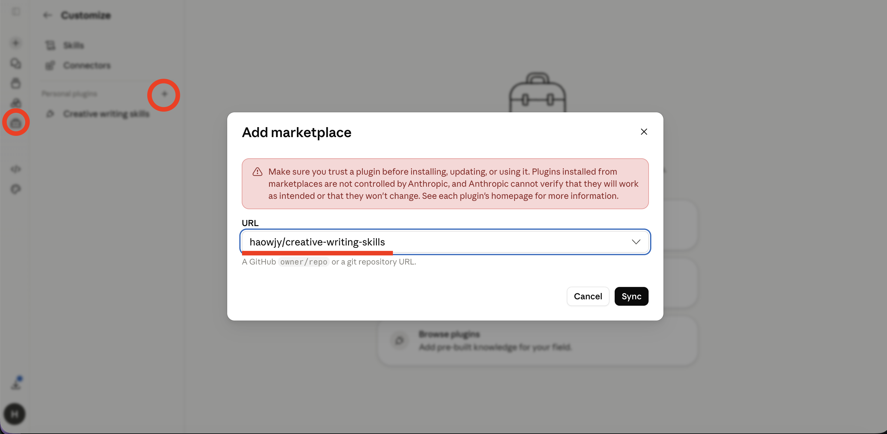
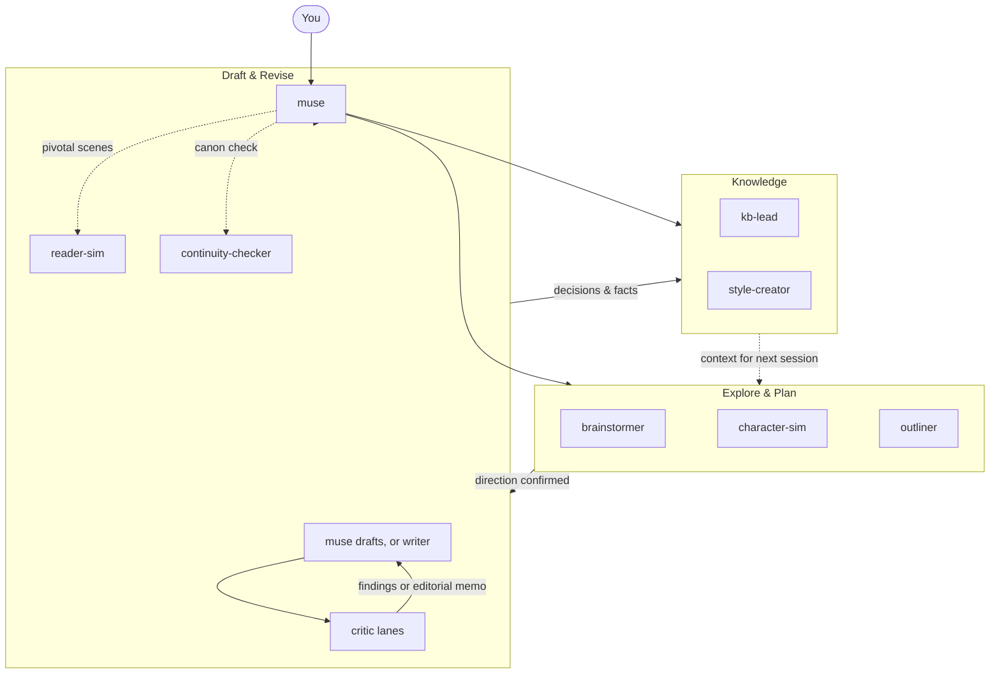

# Creative Writing Skills

[](https://github.com/haowjy/creative-writing-skills/actions/workflows/ci.yml)
[](LICENSE)

Write novels, short stories, and serial fiction with AI that keeps your voice, tracks your continuity, and gets better the more you use it. From first brainstorm to polished draft, muse, your creative partner, talks through the story with you, drafts and revises in your voice, and draws on shared skills for the craft. Where your app runs agents, specialists take the critique, reader-reaction and continuity passes in sessions of their own.

**What you get:**
- **Brainstorm without committing**: explore plot options, character arcs, and world mechanics before deciding anything
- **Write in your voice**: create style files from your existing prose, then draft new scenes that match
- **Catch your own mistakes**: structured critique, continuity checks, and simulated reader reactions
- **Keep everything in sync**: a knowledge base of characters, canon and timeline that updates as your story evolves

## Quick Start

1. **Install** for your app: [Claude.ai](#claudeai), [Claude Code or Cowork](#claude-code-and-cowork), or [Codex, Cursor, OpenCode or Grok](#codex-cursor-opencode-and-grok).
2. **Run project setup once, before you write anything.** Muse never starts it for you:

   | App | Run |
   |---|---|
   | Claude.ai | turn on `project-setup` and ask it to set up your project |
   | Claude Code / Cowork | `/creative-writing-skills:project-setup` |
   | Codex, Cursor, OpenCode, Grok | the `project-setup` skill |

   It interviews you about the project, collects writing samples, and creates your `AGENTS.md` (the project's conventions), the `kb/` knowledge base layout and your first style files. Everything muse does reads those, so skipping this step makes it guess your conventions.
3. **Start writing with muse**: turn on `creative-writing-muse` (Claude.ai, Cowork, Codex, OpenCode), or start the `muse` agent (`claude --agent creative-writing-skills:muse` in Claude Code; choose `muse` as the agent in Cursor and Grok).

## Installation

### Claude.ai

`creative-writing-muse` turns an ordinary Claude chat into a creative writing partner. Turn it on, tell it what you're working on, and it carries you from first idea to finished draft in one conversation: talking through ideas, drafting scenes in your voice, flagging what isn't working, and revising. The other skills (prose, scene craft, critique, structure) are the craft knowledge it draws on; you don't have to invoke them yourself.

First, add the skills to claude.ai. Pick one:

- **Add the marketplace (easiest):** in the sidebar, **Customize** → **Personal plugins** → **+** → **Create plugins** → **Add marketplace** → **Add from repository**, enter `haowjy/creative-writing-skills`, and click **Sync**.

  
- **Upload the files:** download the `.skill` files from the [latest release](https://github.com/haowjy/creative-writing-skills/releases/latest), then **Customize** → **Skills** → **"+"** → **Upload skill** for each one.

Then start a chat, turn on **`creative-writing-muse`**, and describe what you want to write; it leads from there. Adding skills one at a time instead? Start with **creative-writing-muse** and **story-workflow**, which holds muse's method, then **writing-principles**, **creative-writing-craft**, **story-planning**, **story-review**, and **story-memory**.

Run **`project-setup`** once before writing. On claude.ai it gives you the `AGENTS.md`, kb layout, and style guidance as text to save in your project.

The plugin's agents show up grayed out in a claude.ai chat: chat runs skills only, so muse runs every pass itself, in one conversation.

> Want to build the files yourself? Clone the repo and run `python scripts/create_skill_zips.py` to regenerate them in `zips/`. It packages the committed `plugin/claude/skills` tree.

### Claude Code and Cowork

Claude Code and Cowork use the same plugin, and both run the agents.

**Claude Code**: add the marketplace and install:

```bash
/plugin marketplace add haowjy/creative-writing-skills
/plugin install creative-writing-skills@creative-writing-skills
```

**Cowork**: in the sidebar, **Customize** → **Personal plugins** → **+** → **Create plugins** → **Add marketplace** → **Add from repository**, enter `haowjy/creative-writing-skills`, then install the **creative-writing-skills** plugin.

Run the one-time project setup to create your `AGENTS.md`, `kb/` layout, and style files:

```
/creative-writing-skills:project-setup
```

Then start writing with muse. **Claude Code**: start a session with muse as your agent:

```bash
claude --agent creative-writing-skills:muse
```

**Cowork**: turn on **creative-writing-muse** and describe the project; muse hands work to the other agents from there.

### Codex, Cursor, OpenCode and Grok

The plugin builds for these too. Codex and OpenCode load the skills but not the agents, so turn on `creative-writing-muse` and work in one session; Cursor and Grok load both.

```bash
# Codex
codex plugin marketplace add haowjy/creative-writing-skills
codex plugin add creative-writing-skills@creative-writing-skills

# Cursor: then install the plugin from Cursor's Customize UI
agent plugin marketplace add https://github.com/haowjy/creative-writing-skills

# OpenCode
opencode plugin add git+https://github.com/haowjy/creative-writing-skills.git

# Grok
grok plugin marketplace add https://github.com/haowjy/creative-writing-skills
grok plugin install creative-writing-skills --trust
```

## How It Works

Muse talks, plans and drafts with you, and decides what to do with every draft and critique. Where agents run, it hands the passes that read better from outside to specialists in their own sessions; where they don't, it runs each pass itself, one at a time, with the same skills.



**Explore:** brainstorm options from several angles, talk to your characters to find their voices, and outline once a direction is chosen.

**Draft & Revise:** muse drafts and revises with you. Where agents run, it hands `writer` the passes that need their own session: an alternate take on another model, a polish pass you ask for, or a very long draft. Each critique runs one lane: a focus area for depth on one craft dimension, or an edit level, where editorial review gives a book editor's priorities across structure, voice, line quality, and surface. After two critique rounds on a chapter, muse brings you what is still open and you decide. A simulated reader gives moment-by-moment reactions to pivotal scenes.

**Knowledge:** when a chapter, revision, or ruling settles, muse records what settled in the kb (through `kb-lead` where agents run), so a trial direction stays a trial. Style files capture your voice from prose samples. The kb grows with the project, so every later session starts with accurate context.

## Agents

Claude Code, Cowork, Cursor and Grok run these. Elsewhere muse does each job itself with the matching skill.

| Agent | Role |
|---|---|
| **muse** | Author-facing creative partner for all story work: talks, plans, and drafts with you, hands off critique and knowledge capture, and owns the verdict |
| **spark** | Budget creative partner with muse's posture: brainstorms, advises and drafts with you in one session, handing off to no one |
| **setup** | Runs `/project-setup` with you once, for apps where you start a chat with an agent instead of a skill |
| **writer** | Production prose in one mode (draft, revision, bridge, alternate take, line polish) for passes that need their own session |
| **critic** | Diagnoses a draft in one lane: a focus area (structure, character, voice, prose, continuity) or an edit level (editorial review, developmental, line edit, copyedit, proofreading) |
| **reader-sim** | Experiential reader response to a draft, moment by moment |
| **character-sim** | In-character conversation for voice discovery and relationship testing |
| **continuity-checker** | Cross-references content against established canon for contradictions |
| **creative-researcher** | Web research for real-world grounding: historical and cultural detail, domain accuracy, primary sources, flagging where the story's assumptions are wrong |
| **brainstormer** | Creative option generation for a scoped question or angle |
| **outliner** | Sequences confirmed direction into arc, chapter, and beat-level outlines |
| **style-creator** | Analyzes prose samples to produce style reference files for the project's voice |
| **kb-lead** | Records settled work in the kb; the agent behind `story-memory` |

Four general-purpose helpers ship with them for the work around the writing: `explorer` finds what's related in a large project, `session-miner` finds where past sessions discuss a question, `cold-reader` checks notes and docs for what a reader who wasn't there cannot follow, and `kb-maintainer` restructures a knowledge base.

## Skills

| Skill | Purpose |
|---|---|
| **creative-writing-muse** | The muse's method: one creative partner that talks, plans, drafts, and revises with you; turn it on in any app |
| **creative-writing-craft** | Prose modes (fresh draft, revision, bridge, alternate take, line polish) and craft references for prose, scenes, style, voice, and genre |
| **writing-principles** | Reader reward channels, AI failure modes, and fiction-specific taste discipline |
| **story-planning** | Direction, brainstorming, outlining, and story architecture before pages exist |
| **story-review** | Editorial review, developmental edit, line edit, copyedit, proofreading, craft critique, and reader-signal synthesis |
| **story-memory** | Context, fact extraction, reference writing, kb layout, and persistent issue tracking |
| **story-workflow** | The lifecycle of story work: intent, direction, drafting, critique rounds, the verdict, knowledge capture, presenting |
| **reader-sim** | First-time reader simulation from a specified persona |
| **character-sim** | In-character conversation for voice and relationship testing |
| **creative-research** | Research for factual grounding: historical detail, cultural texture, domain accuracy, how other authors handled similar material |
| **writing-staffing** | Which agent takes which lane, what to tell it to load, and how many lanes to run (only where agents run) |
| **project-setup** | One-time guided setup (you start it): interviews you, then creates `AGENTS.md`, the kb layout, and style files |
| **llm-writing** | Plain words and reader-first discipline for notes, briefs and reports; strips default LLM phrasing |
| **shared-dao** | Shared vocabulary: canonical story terms, aliases, and ambiguity resolution |

The plugin also ships general skills these load, for keeping the project's notes and knowledge base in order: `intent-modeling`, `explore-and-engage`, `grill`, `knowledge-layers`, `qi-layer` and `qi-maintenance` (writing and maintaining `AGENTS.md`), `shared-workspace`, `md-validation`, `structured-artifact`, and `atlas` (a clickable map, such as your cast and their relationships). `writing-sync` syncs chosen files to Google Docs for reading and brings edits back; it needs a shell, so it isn't in the claude.ai uploads.

## Project Layout

```text
my-story/
├── AGENTS.md              # Project conventions (created by project-setup)
├── story/                 # Chapters and manuscript
├── work/                  # Current drafting effort
│   ├── outline/
│   ├── drafts/
│   ├── critique-reports/
│   └── brainstorm/
└── kb/                    # Durable knowledge base
    ├── styles/            # Voice reference files
    ├── characters/        # Character state and profiles
    ├── world/             # Locations, lore, systems
    ├── timeline/          # Chronology
    ├── canon/             # Established facts
    └── issues/            # Tracked writing problems
```

## Compatibility

| Feature | Claude.ai | Claude Code / Cowork | Cursor / Grok | Codex / OpenCode | Meridian |
|---|:---:|:---:|:---:|:---:|:---:|
| Skills | Marketplace or upload | Yes | Yes | Yes | Yes |
| Agents | No (grayed out in chat) | Yes | Yes | No | Yes |
| Lanes on another provider's model | No | No | No | No | Yes |
| Project setup | Text to save | Writes files | Writes files | Writes files | Writes files |

## Advanced: Meridian

[Meridian](https://github.com/haowjy/meridian-cli) is a command-line tool that lets agents in Claude Code, Codex, OpenCode, Cursor and Pi start each other. With it, muse can hand a lane to a model from another provider: an alternate take, or the same high-stakes critique sent to two model families whose blind spots differ. A harness's own agent tool reaches only its own provider.

```bash
meridian mars add haowjy/creative-writing-skills
meridian mars sync
```

Then run `meridian` in the project directory: the session runs as muse, and a new project runs setup on first launch (`meridian bootstrap` runs it again). `writer` defaults to Opus at high effort.

## Development

`plugin/`, the marketplace catalogs and the root `package.json` are generated by Mars from `agents/`, `skills/`, `bootstrap/` and the dependency graph, and CI fails when they are stale. The commands, release steps and rules for changing this package are in [AGENTS.md](AGENTS.md).

## License

Apache License 2.0. See [LICENSE](LICENSE).
